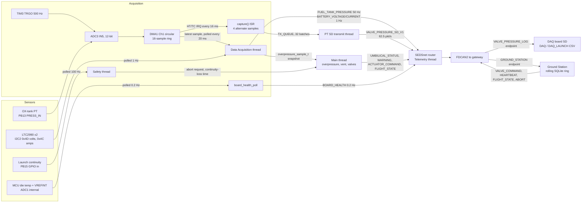
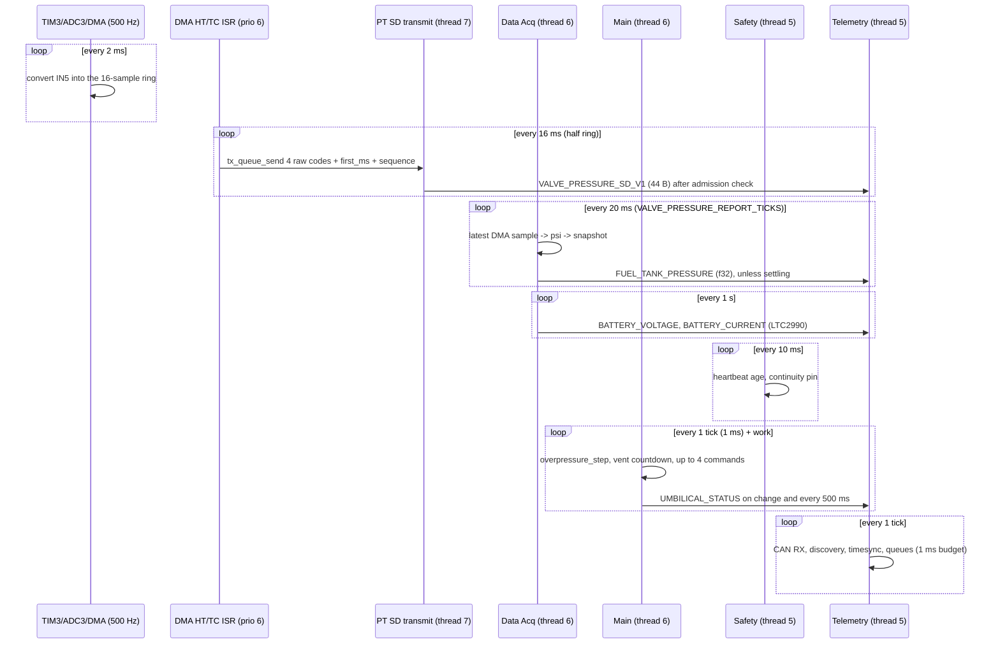
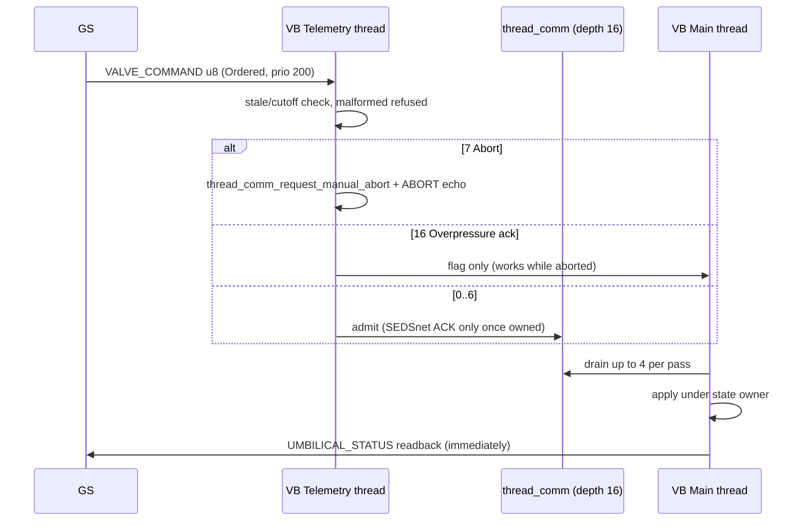

# Valve Board data pipeline

This document traces every Valve Board (VB) input, from the pin to where the
Ground Station (GS) stores it. Every number below comes from the source. File
and line references are relative to this repository unless they name
`GroundStation26/` or `DAQ-Board/`. Values were checked against the `dev`
branch of all three repositories on 2026-11-22.

The VB has **no SD card**. It does two things with the OX-tank pressure
transducer:

- It publishes a decimated live stream (`FUEL_TANK_PRESSURE`, 50 Hz) to the GS.
- It sends a lossless 250 Hz archive stream (`VALVE_PRESSURE_SD_V1`) to the
  DAQ board, which writes it to its own SD card.

## 1. Overview

The sampling, control and publishing schedule:

## 2. Threads, ISRs, timers and DMA

ThreadX ticks at 1000 Hz (`Core/Inc/tx_user.h:240`). A lower number means a
higher priority. No thread uses time slicing.

| Context | Priority | Period / trigger | Work | Source |
|---|---|---|---|---|
| Telemetry thread | 5 | `tx_thread_sleep(1)` loop | CAN RX drain (16 ms budget), discovery and `BOARD_HEALTH` poll, timesync, OTA, `process_all_queues_timeout(1)`, abort-report retry (at most 1/s) | `Core/Src/telemetry_thread.c:91-140`, `Core/Src/can_bus.c:188` |
| Safety thread | 5 | every 10 ticks (`SAFETY_CHECK_PERIOD_TICKS`) | GS heartbeat timeout (5000 ms), continuity pin | `Core/Src/safety_thread.c:17-19,131-158` |
| Main thread | 6 | `tx_thread_sleep(1)` loop | overpressure, post-Launch vent, Launch sequence, up to 4 commands per pass, status publication | `Core/Src/main_thread.c:36,634-735` |
| Data Acquisition thread | 6 | 20 ticks, minus work time, at least 1 | PT live sample and snapshot. LTC2990 power at 1 s, with failed-device retry every 5 s | `Core/Src/data_acq_thread.c:18-22,215-258`, `Core/Inc/telemetry_rates.h:5-27` |
| PT SD transmit thread | 7 | blocks on capture queue | Converts and encodes 4-sample batches and publishes `VALVE_PRESSURE_SD_V1` | `Core/Src/pressure_sd.c:172-238` |
| DMA1_Channel1 IRQ (ADC3) | NVIC 6 | DMA half and full transfer, every 16 ms | `HAL_ADC_ConvHalfCpltCallback` / `ConvCpltCallback` → `capture()` | `Core/Src/main.c:607`, `Core/Src/pressure_sd.c:73-117` |
| FDCAN2 IT0/IT1 IRQ | NVIC 6 | CAN frame RX/TX | Drains FIFO into a 64-frame ring | `Core/Src/stm32g4xx_hal_msp.c:267-269`, `Core/Src/can_bus.c:181` |
| USB_LP IRQ | NVIC 5 | USB | CDC debug only | `Core/Src/stm32g4xx_hal_msp.c:533` |
| TIM6 (HAL tick) | NVIC 15 | 1 kHz | `HAL_IncTick` | `Core/Inc/stm32g4xx_hal_conf.h:184`, `Core/Src/main.c:867-879` |
| TIM3 | – (no IRQ) | 170 MHz / 1700 / 200 = 500 Hz TRGO | ADC3 trigger | `Core/Src/main.c:514-549` |
| TIM2 CH1/CH2 PWM | – | 170 MHz / 170 / 20000 = 50 Hz | Dump servo (PA0), Normally-open / vent servo (PA1) | `Core/Src/main.c:455-511`, `Drivers/Servo/servo_driver.h:8-20` |

FDCAN2 runs FD without BRS. The nominal bit uses 2 × (1+19+4) = 48 PCLK1
clocks (`Core/Src/main.c:376-384`). With PCLK1 = 170 MHz (`main.c:212-229`)
that is about 3.54 Mbit/s.

## 3. Channels and streams

### 3.1 Sensor channels

| Item | OX-tank pressure (live) | OX-tank pressure (archive) | Battery voltage | Battery current | Continuity | Die temperature |
|---|---|---|---|---|---|---|
| Sensor | Tank PT, 0–2000 psi span | same PT | LTC2990 @0x4D, V2 × 5.7 divider | LTC2990 @0x4C, 20 mΩ shunt | Launch continuity wire | STM32 TS + VREFINT |
| Pin / ADC | PB13, ADC3 IN5, 47.5-cycle sample (`pressure_transducer_driver.c:111`) | same | I2C2 | I2C2 | PB15 input, no pull (`main.c:646-650`) | ADC1 internal, 640.5 cycles (`board_temperature.c:62-63`) |
| Sample rate | 500 Hz, TIM3 | 500 Hz | on demand: trigger, then 10 ms conversion (`ltc2990.c:150-152`) | same | – | on demand |
| Read rate | 50 Hz: newest ring entry (`pressure_transducer_driver.c:119-131`) | 250 Hz: every second conversion of each half ring (`pressure_sd.c:104`) | 1 Hz (`data_acq_thread.c:19,189`) | 1 Hz | 100 Hz | 0.2 Hz (`board_temperature.c:16`) |
| Filtering | none. Point sample, ≤ 2 ms old. Decimation without anti-aliasing | none. Decimation by 2 | none | none | **no debounce**: one sample acts | none |
| Processing | linear: `psi = (code − 0)·2000/(3103 − 0)`. Codes ≤ 8 give 0 psi; result clamped to 0–2000 (`pressure_transducer_driver.c:6-28,77-103`). Not published for 1000 ms after ADC start (`PRESSURE_TRANSDUCER_SETTLE_MS`) | same conversion, done in the thread (`pressure_sd.c:195`). The ISR drops samples during the settle window (`pressure_sd.c:76`) | `code·5/16384·5.7` (`ltc2990.h:25,31`, `ltc2990.c:281-299`) | `code·19.42 µV/(0.02·10k/81.5k)`, then `·0.58047616 − 1.4267476` (`ltc2990.h:35-43`, `ltc2990.c:301-311,358-368`). NaN is dropped (`ltc2990.c:23-26`) | `GPIO_PIN_SET` = present (`safety_thread.c:20-22`) | factory TS_CAL1/2 and VREFINT_CAL (`board_temperature.c:19-29`) |
| Units / calibration | psi, fixed in firmware. No runtime calibration. Load-cell temperature compensation does not apply | psi plus raw 12-bit code | V | A | – | 0.01 °C, packed into health word 1 |
| SD save | none on the VB | DAQ SD, every sample (see §4.3) | none | none | none | none |
| Network type | `FUEL_TANK_PRESSURE` (id 79920485, f32×1) | `VALVE_PRESSURE_SD_V1` (id 157797238, u8×44) | `BATTERY_VOLTAGE` f32×1 | `BATTERY_CURRENT` f32×1 | none. Only abort reasons and vent warnings carry it | `BOARD_HEALTH` u32×24 word 1 bits 16–31 |
| Send rate | 50 Hz producer target (`telemetry_rates.h:5-7`) | one packet per 16 ms half ring (62.5 pkt/s, 4 samples each) | 1 Hz | 1 Hz | – | every 5 s (`board_health.c:27`) |
| Reliability / priority | reliable Off, priority 0, endpoints GROUND_STATION + SD_CARD (`config/sedsnet.json`) | reliable Unordered, priority 0, endpoint VALVE_PRESSURE_LOG only | Unordered, 0 | Unordered, 0 | – | Off, 0 |
| Egress policy | queued (`seds_router_log_queue_typed`, `telemetry.c:1527-1548`). CAN data band `0x106` (`board_can_priority.h:20-21`). The CAN TX queue drops frames older than 1000 ms (`can_tx_queue.c:11,105-108`) | Admission is refused while committed reliable traffic ≥ window − max(4, 25 %) (`pressure_sd_admission.h:254-293`). A refused batch keeps its bytes and clocks and retries every 1 ms; each call has a 200 ms budget (`pressure_sd.c:124-171,204-215`). Overflow of the 32-batch capture queue is a counted loss | queued, data band | queued, data band | – | `seds_router_log_bytes_ex(..., true)` (`board_health.c:49`) |
| Board latency | ≤ 2 ms sample age + ≤ 20 ms report phase + telemetry service (1 tick loop) | 14–16 ms ISR capture age. Wire timestamps are back-projected to capture time (`pressure_sd.c:88`, `pressure_sd_clock.h:312-321`) | about 10–20 ms conversion wait | same | detection ≤ 10 ms | up to 5 s |

`VALVE_PRESSURE_SD_V1` wire layout (`Core/Inc/pressure_sd_wire.h:329-362`),
little-endian:

| Bytes | Content |
|---|---|
| 0–7 | `uptime_ms` (u64) of the first sample. Advanced by sequence × 4 ms, not by HAL drift (`pressure_sd_clock.h:304-311`) |
| 8–15 | `unix_ms` (u64), back-projected network UTC. 0 if unknown |
| 16–19 | `first_sequence` (u32). Counts acquired samples, including queue drops |
| 20–43 | 4 × (raw u16 + psi f32), 4 ms apart |

The encoder rejects raw > 4095 and psi outside 0–2000 (`pressure_sd_wire.h:353-354`).

### 3.2 Board status and event streams

| Stream | SEDSnet type (reliable, priority) | Trigger / rate | Payload | Source |
|---|---|---|---|---|
| Valve output state | `UMBILICAL_STATUS` (Ordered, 200) | Immediately after every output change or refused command. All four are published every 500 ms, or every 500 ms while aborted. Pending reports retry every 100 ms. During Launch the pilot is reported every 100 ms | `[cmd_id, 0/1]`. IDs: 0 pilot, 1 normally-open (vent), 2 dump, 6 Launch sequence. The state is **read back from registers** (servo CCR, solenoid ODR) under the state owner, never cached (`main_thread.c:561-601`, `status_report_retry.h:20-45`). Stamped with router network time and deferred until it is known (`telemetry.c:1046-1102`) | `main_thread.c:30,34-37,82-109,471-486` |
| Overpressure reports | `WARNING` (Unordered, 0) | On each trip, fault or acknowledgement. Re-announced every 1 s while latched. Retried every 50 ms | `Valve Board overpressure <stage>: <psi> psi [<code><trip>]` (`overpressure.c:217-243`) | `main_thread.c:310-354` |
| Auto-vent reports | `WARNING` | On state change, and every 5 s while counting or vented | `vent_countdown_format_report` | `vent_countdown.h:44-46`, `main_thread.c:542-550` |
| Automatic abort | `ABORT` string (Unordered, 0) | Once per abort epoch, retried at most 1/s | `SEDS_AUTO_ABORT_V1:<reason>` | `telemetry_thread.c:50-89` |
| Manual abort echo | `ABORT` | On a received `VALVE_COMMAND` 7 | `Valve board abort command` | `telemetry.c:274-279,333-340` |
| Launch | `FLIGHT_STATE` (Ordered, 16) = LAUNCH and `ACTUATOR_COMMAND` 14 (Ordered, 200) | Once, when the Launch is accepted, stamped at the command's network time | – | `main_thread.c:203-222` |
| Supply close / AB abort | `ACTUATOR_COMMAND` 12 \| 0x80, 13 \| 0x80, 16 \| 0x80 | On an overpressure relief trip. Retried every main-loop pass until accepted | – | `main_thread.c:317-333,378` |
| Health | `BOARD_HEALTH` (Off, 0) | 5 s | uptime, watchdog flags, allocator counters, CAN RX drops, die temperature | `board_health.c:19-56` |

The VB sends no `HEARTBEAT` in flight builds. `sim_probe_emit_heartbeat` is
compiled only with `SEDS_FIRMWARE_SIM_TEST` (`sim_network_probe.h:120-175`).

### 3.3 Commands and acknowledgements

- Valve command IDs (`Core/Inc/board_commands.h`): 0 pilot open, 1 vent (NO)
  open, 2 dump open, 3 pilot close, 4 vent close, 5 dump close, 6 Launch
  sequence, 7 abort, 16 overpressure acknowledgement. Bit 0x80 tags an
  automatic command, accepted only for 0–5 (`telemetry.c:313-319`).
- The SEDSnet reliable ACK is returned only after the control queue owns the
  command. A full queue returns an error so the SDK retries
  (`telemetry.c:344-353`).
- Application confirmation is the `UMBILICAL_STATUS` readback, published
  inside the same main-loop pass that applied the command.
- Board-side latency from command receipt to output: at most one telemetry
  loop plus one main-loop pass (≈ 1–2 ms) when the main thread is not blocked.
  It can be longer while the equal-priority Data Acquisition thread runs (see
  §5).
- Launch timeline: the pilot solenoid opens 10 000 ms after the accepted
  Launch deadline and closes after 1500 ms (`main_thread.c:31-33,231-276`).

### 3.4 Safety logic

| Function | Rule | Debounce / latency | Source |
|---|---|---|---|
| Overpressure relief | psi ≥ 850 sustained → open dump and vent, send N2/N2O close and AB abort | Every counted sample must be over the threshold for 250 ms of acquisition time (≈ 13 samples at 50 Hz). A gap > 250 ms restarts the timer | `overpressure.h:258-273`, `overpressure.c:23-33,96-102` |
| Overpressure abort | psi ≥ 950 sustained → relief, plus pilot open for 3000 ms, then pilot close and abort | as above, + 3000 ms | `overpressure.c:115-140` |
| After Launch | a trip only reports (`[L...]`); no valve moves | – | `overpressure.c:120-123`, `main_thread.c:371` |
| Plausibility | a step > 150 psi per 20 ms (7500 psi/s) is a fault and resets the trip timers. Readings count again after 1000 ms without such a step | – | `overpressure.h:267-273` |
| Invalid / stale | raw ≥ 3103 or ≥ 4095, NaN or out of range → `F` fault. No valid sample for 2000 ms → `S` fault | 2000 ms | `overpressure.c:10-21,107-113` |
| Acknowledge | cmd 16. Accepted only when no pilot window is running, a fresh sample exists and psi < 850. No valve moves | – | `overpressure.c:159-172` |
| Heartbeat abort | no GS heartbeat for 5000 ms, armed after the first heartbeat, in Idle < state < Launch | checked every 10 ms | `safety_thread.c:53-81`, `thread_comm.c:846-854` |
| Continuity abort | pin not `SET` → abort in Startup < state < Launch | **single 10 ms sample** | `safety_thread.c:83-102`, `thread_comm.c:835-843` |
| Post-Launch auto-vent | link loss or a continuity break starts a countdown. The vent fires at max(start + 150 s, Launch + 60 s) | link loss is detected after 5 s | `vent_countdown.h:40-46` |
| Abort safe state | vent open, dump open, pilot off. Statuses every 500 ms | – | `main_thread.c:168-187,461-486` |

The control latency from tank pressure crossing 850 psi to the relief command
is 250 ms (sustain) + up to 20 ms (sample phase) + up to one main-loop pass.

## 4. Where each stream is stored

### 4.1 Summary

| Stream | Saved on the VB | Saved on the DAQ SD | Reaches the GS | Saved by the GS |
|---|---|---|---|---|
| OX-tank psi, 250 Hz raw + psi | no | yes, every sample | no | only as part of a downloaded DAQ CSV attached to a capture |
| `FUEL_TANK_PRESSURE` 50 Hz | no | the type lists SD_CARD, but the DAQ records the 250 Hz archive instead | yes | every sample: raw row + derived `PRESSURE_TRANSDUCER_CALIBRATED` |
| `BATTERY_VOLTAGE` / `_CURRENT` | no | the type lists SD_CARD | yes | raw rows + derived battery rows |
| `UMBILICAL_STATUS` cmd 0–2 | no | – | yes | synthetic `VALVE_STATE` rows |
| `UMBILICAL_STATUS` cmd 6 | no | – | yes | **not recorded** (it only drives the GS launch clock) |
| `WARNING` (overpressure, vent) | no | the type lists SD_CARD | yes | `alerts` table |
| `ABORT` | no | the type lists SD_CARD | yes | abort state and history |
| `BOARD_HEALTH` | no | – | yes | raw row with the payload |
| `FLIGHT_STATE` (Launch) | no | the type lists SD_CARD | yes | raw row. Only the FC moves the global state |

The VB has no persistent data log. It keeps only small markers in TAMP backup
registers and internal flash (Launch latch, abort latch, vent marker), and it
has no SD hardware.

### 4.2 Ground Station

All paths are in `GroundStation26/backend/src/`.

- **Decode.** The GROUND_STATION endpoint handler handles `UMBILICAL_STATUS` at
  ingress (`main.rs:2089-2130`) and pushes everything else to the telemetry
  task (`main.rs:2132-2137`). `ABORT` has its own handler (`main.rs:2160-2170`).
  - `FUEL_TANK_PRESSURE` uses the generic f32 path. The GS treats it as sensor
    `IADC` (`telemetry_task/derived.rs:624-629`) and applies the GS `iadc`
    linear fit. The shipped fit is identity (`m = 1`, `b = 0`). The result is
    stored as `PRESSURE_TRANSDUCER_CALIBRATED` (`telemetry_task/loadcell.rs:17`).
    Each VB packet also runs the GS overpressure layer (`telemetry_task.rs:3312-3316`), which has its own
    configurable 850/950 psi defaults (`gse/overpressure.rs:5-9`).
  - `UMBILICAL_STATUS` is accepted only when cmd 0–6 comes from `VB`
    (`telemetry_task.rs:2357-2363`). It becomes an 8-wide `VALVE_STATE` row:
    pilot, NO, dump, igniter, N2, N2O, retract (`telemetry_task.rs:2099-2121`).
  - VB `WARNING` strings are parsed by tag (`gse/overpressure.rs:132-155`,
    `gse/auto_vent.rs:23-88`).
- **Rolling recording.** SQLite segments of 64 MB in
  `data/recordings/rolling/segment_<UTC>.db`, with a ring budget of up to 50 GB
  (`recording_store.rs:190-244`). Every decoded sample is kept
  (`telemetry_task/derived.rs:47-54`), with its raw packet JSON. Rows are
  batched by 256 rows or 8 ms (`telemetry_task.rs:52-53`).
- **Event captures.** All tables in the window are copied to
  `data/recordings/events/<kind>/<stamp>_<label>/recording.db`. Windows
  (pre/post): Launch 600/300 s, Abort 300/300 s, Fill 120/120 s, ValveSelfTest
  60/60 s, ColdFlow 120/180 s (`recording_store.rs:127-161`). The test-fire CSV
  includes `FUEL_TANK_PRESSURE`, `IADC` and `PRESSURE_TRANSDUCER_CALIBRATED`
  but not `VALVE_STATE` (`test_fire_csv.rs:58-70`).
- **Burn report.** The GS has no dedicated burn report. The generic report
  studio (`recording_report.rs` and `recording_report.py`) renders any
  recording or capture to CSV, xlsx or PDF on request and stores nothing.
- **Command confirmation.** The GS sets a pending valve target and clears it
  when a matching fresh `UMBILICAL_STATUS` arrives. After 5000 ms without a
  match, both the pending and confirmed state are dropped (`state.rs:33-34`).
  `valve_report_health.rs:14-17` assumes the 500 ms board report period.

### 4.3 DAQ board SD (the VB pressure archive)

The DAQ firmware (`DAQ-Board/`) receives `VALVE_PRESSURE_SD_V1` on its
`VALVE_PRESSURE_LOG` endpoint (`Core/Src/telemetry.c:673,788`). It writes each
of the four samples as channel `valve_pressure_psi`, with the raw code and psi
unchanged (`Core/Src/sd_card.c:1043,1710`).

- When the VB UTC is known, samples from Launch acceptance up to T+20 s go to
  the `DAQ_LAUNCH_*.CSV` file. Earlier and later samples go to the ordinary
  `DAQ_*.CSV` session files (`DAQ-Board/README.md:509-520`,
  `sd_card.c:329,1030`).
- The GS can download SD files only from the DAQ (`sd_download.rs:60-63`), and
  only in Idle, Landed or Recovery. It attaches `DAQ*.CSV` files to a capture
  by UTC overlap within ±5 s, under `<capture>/board_sd/DAQ/`
  (`recording_store/board_sd.rs:58-74`).

## 5. Known gaps and bugs found

No firmware was changed. Items are ordered by operational impact.

1. **The continuity abort has no debounce.** One 10 ms read of PB15 that is not
   `SET` aborts the board in Fill or Armed (`Core/Src/safety_thread.c:83-101`).
   The pin has no pull (`Core/Src/main.c:646-650`). A connector bounce or EMI
   glitch while servos move is enough to abort.
2. **Equal-priority blocking delays control.** The Data Acquisition and Main
   threads both run at priority 6 with no time slice
   (`data_acq_thread.c:254`, `main_thread.c:729`). LTC2990 transactions
   busy-wait in HAL up to `LTC2990_TIMEOUT_MS` = 25 ms per register on failure
   (`ltc2990.h:47`, comment at `data_acq_thread.c:200`). During that time the
   main thread cannot run overpressure or commands. The pressure sample itself
   keeps running through the wait service.
3. **The stream name does not match the sensor.** The OX-tank PT is published
   as `FUEL_TANK_PRESSURE` (`data_acq_thread.c:164`). The DAQ docs call it OX
   tank (`DAQ-Board/docs/sd-record-format.md:73`). The GS has no OX type.
4. **Calibration diverges after a GS fit change.** The board psi is final
   (firmware constants, 3103 codes = 2000 psi). The GS applies its `iadc` fit
   on top for `PRESSURE_TRANSDUCER_CALIBRATED`, while the DAQ SD stores board
   psi. If anyone changes the GS fit from identity, SD and GS pressure will
   disagree.
5. **Live pressure is decimated without a filter.** A point sample is taken
   every 10th conversion. The 250 Hz archive likewise drops every second
   conversion (`pressure_sd.c:104`).
6. **Unused configured ADC.** ADC2 IN6 (`Solenoid_Current`, PC0) is configured
   (`main.c:242-290`) but never started or read.
7. **Stale comment.** `Core/Src/board_temperature.c:54` says "VB shares ADC12
   with pressure ADC2". The pressure ADC is ADC3 (`data_acq_thread.c:45`).
8. **Sequence state is not recorded on the GS.** `UMBILICAL_STATUS` cmd 6
   returns no row (`GroundStation26/backend/src/telemetry_task.rs:2520-2528,
   3121-3126`), so the Launch-sequence state is missing from recordings.
9. **The archive can be lost.** The capture FIFO holds 32 batches (512 ms,
   `pressure_sd.c:20`). A longer congestion or a DAQ outage drops samples.
   Drops are counted in `g_pressure_sd_capture_drops`, but nothing reports them
   over the network.
